<!--
# 🖥🖱 Vítor Alencar

**`FullStack Developer`**
-->
My name is Vítor Alencar Ribeiro, I am a Computer Science student at the Federal University of Brasília. I enjoy developing ideas and working with network security.

📫 Contact me by email: alencarribeirovitor@gmail.com

---

### 📚🤖 Languages and Technologies

 
 
<!--

  

-->

### 📊 Statistics

  
  

  

<!--

    

-->

   

<!--
 

     
 

-->
<picture>
  <source media="(prefers-color-scheme: dark)" srcset="https://raw.githubusercontent.com/vito061/vito061/output/github-snake-dark.svg" />
  <source media="(prefers-color-scheme: light)" srcset="https://raw.githubusercontent.com/vito061/vito061/output/github-snake.svg" />
  
</picture>

